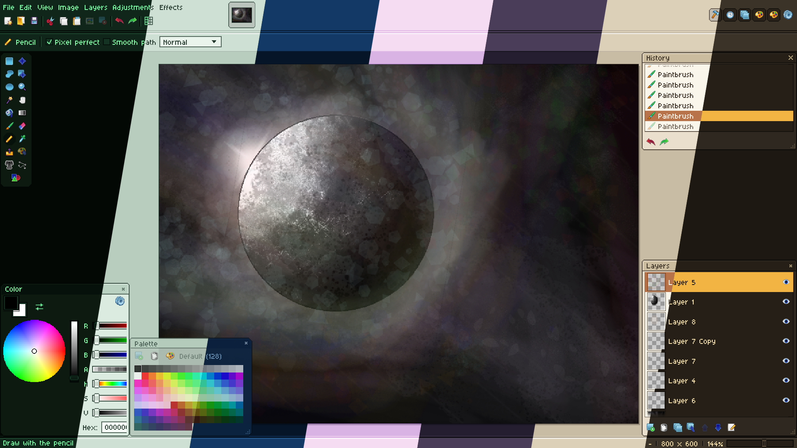
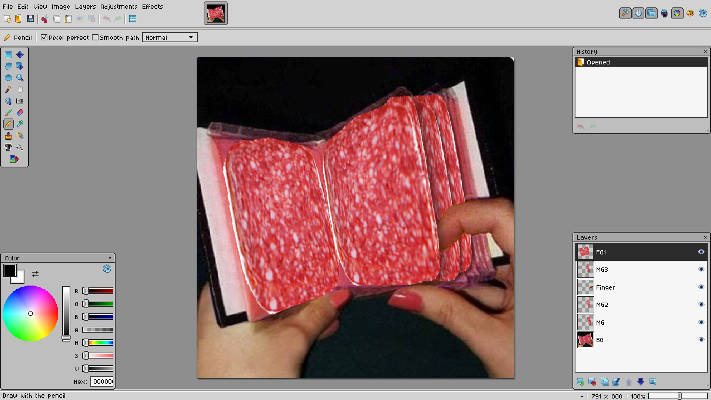
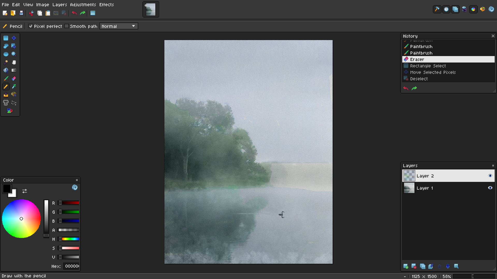
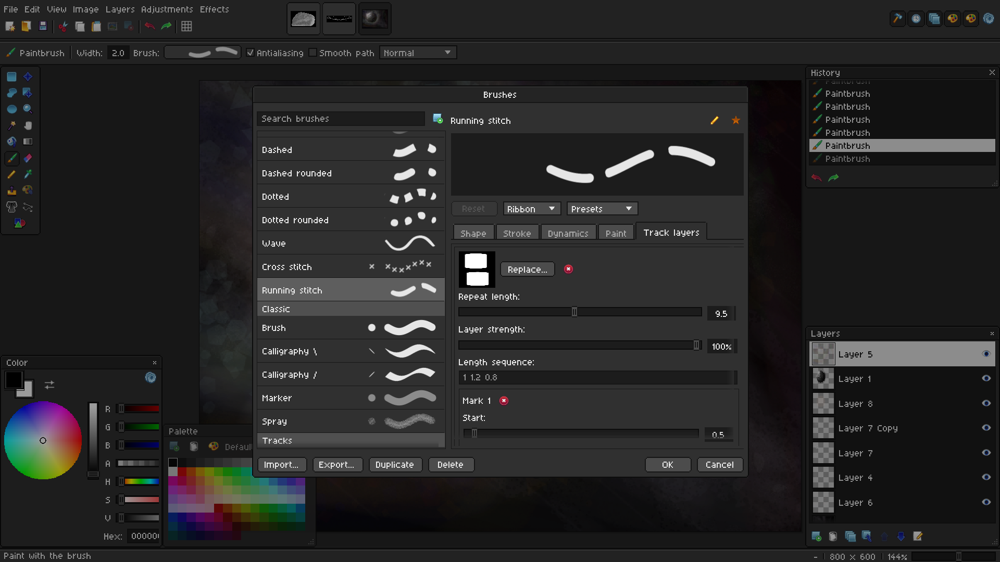
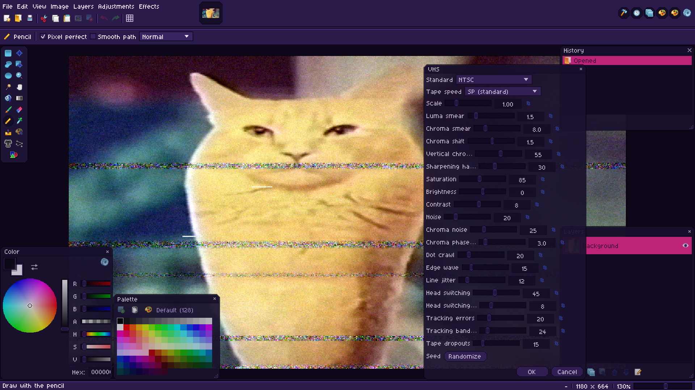
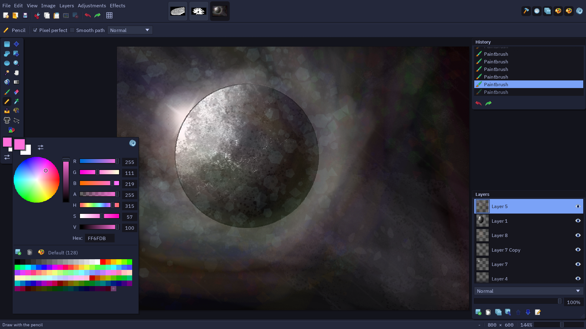
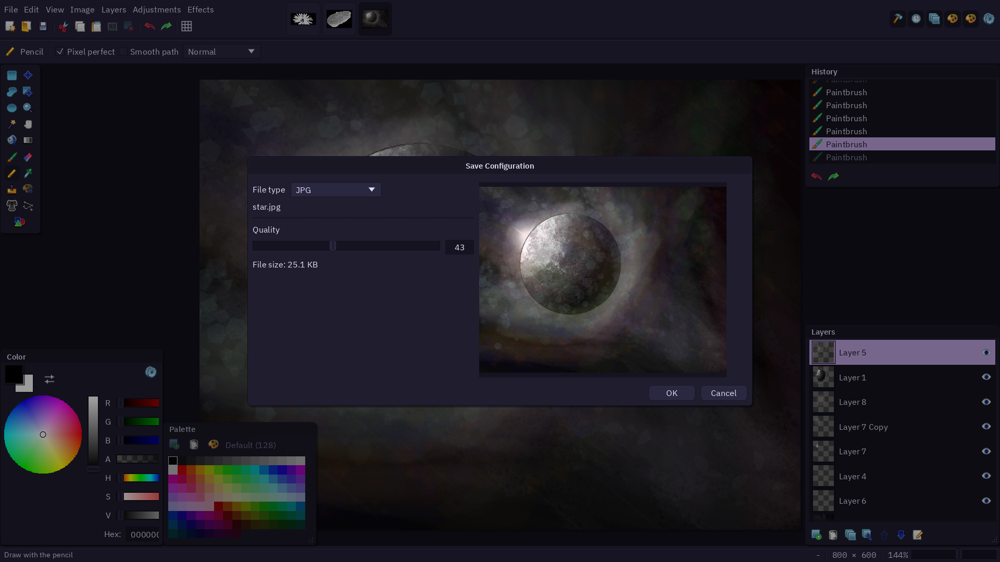
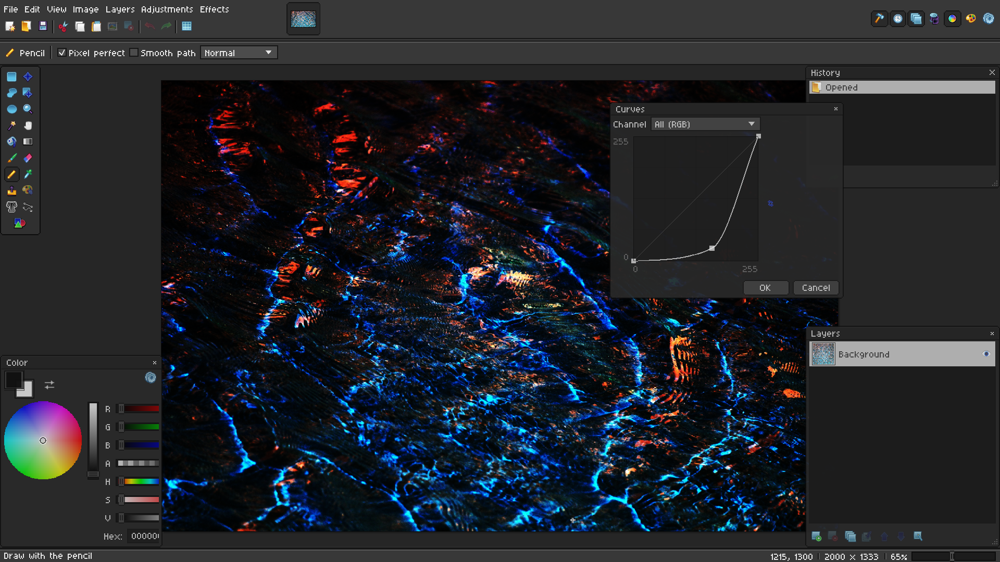
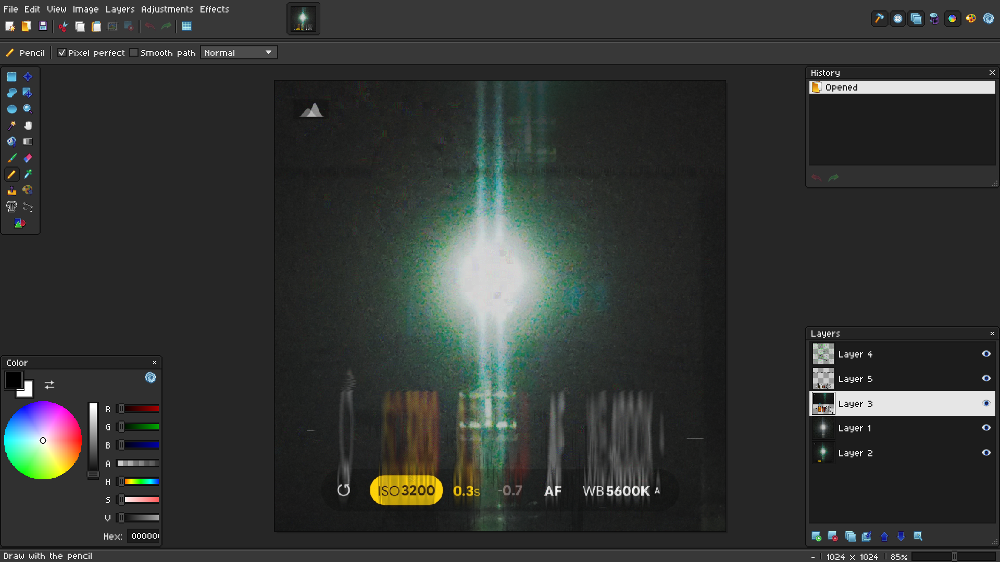

<p align="center">
  
</p>

<p align="center">
  
  
  
</p>

**Chequer Image Studio** is a fast cross-platform raster graphics editor. It is written in Rust and licensed under the GPL. (Cross-platform Paint.NET alternative)

## Features

- Pressure-sensitive pen input and touch gestures
- Brush engine with editable brushes and shareable `.chqbrush` files
- More than 60 effects
- PNG, JPEG, WebP, GIF, BMP, TGA, TIFF, ICO and OpenRaster, plus the native `.chq` format
- Layers, selection tools, gradients, text, shapes, clone stamp
- Custom themes: more than 30 built in, plus your own as `.ini` files
- English and Russian interface (More languages soon...)

## Screenshots

<p align="center">
  
</p>

<p align="center">
  
</p>

<p align="center">
  
</p>

<p align="center">
  
</p>

<p align="center">
  
</p>

<p align="center">
  
</p>

<p align="center">
  
</p>

<p align="center">
  
</p>

<p align="center">
  
</p>

## Build

You need a recent stable Rust toolchain.

```
cargo run --release -p chequer-app
```

For a faster build while hacking (optimized, no LTO):

```
cargo run --profile fastrel -p chequer-app
```

- Android APK: `tools/build_apk.sh` (needs the Android NDK and SDK; set the NDK linker path for `aarch64-linux-android` in `.cargo/config.toml` to match your install)
- Windows installer: `packaging/windows/chequer.iss` (Inno Setup)
- Linux desktop entry and MIME type: `packaging/linux/`

## Documentation

- [Brushes](docs/guide/brushes.md)
- [Themes](docs/guide/themes.md)
- [`.chqbrush` file format](docs/formats/chqbrush.md)

## License

GPL-3.0-or-later, see [LICENSE](LICENSE). Third-party code, fonts and icons are credited in [THIRD_PARTY_NOTICES.md](THIRD_PARTY_NOTICES.md).

Chequer is an independent project and is not affiliated with Paint.NET or dotPDN LLC.

## Credits

Special thanks to [Hundert-Man](https://hundertman.nekoweb.org/) for the application banner and the [icons](THIRD_PARTY_NOTICES.md#icons).
