# Brushes

Chequer paints with brushes. A brush is a tip shape plus a set of settings that describe how the stroke behaves: spacing, pressure response, grain, dryness and so on. The program ships with 87 brushes, and you can edit them, make your own, and share them as `.chqbrush` files.

## Choosing a brush

Select the Paintbrush, the Eraser or the Clone Stamp. In the tool options bar, click the button next to **Brush:**. The **Brushes** dialog opens.

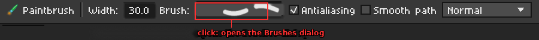

Pick a brush in the list and press **OK**, or double-click it. The brush stays selected between sessions.

- The Paintbrush and the Clone Stamp use the same brush.
- The Eraser has its own brush, so an eraser you set up does not change your painting brush.
- Brush size is not part of the brush. It is set in the tool options bar.

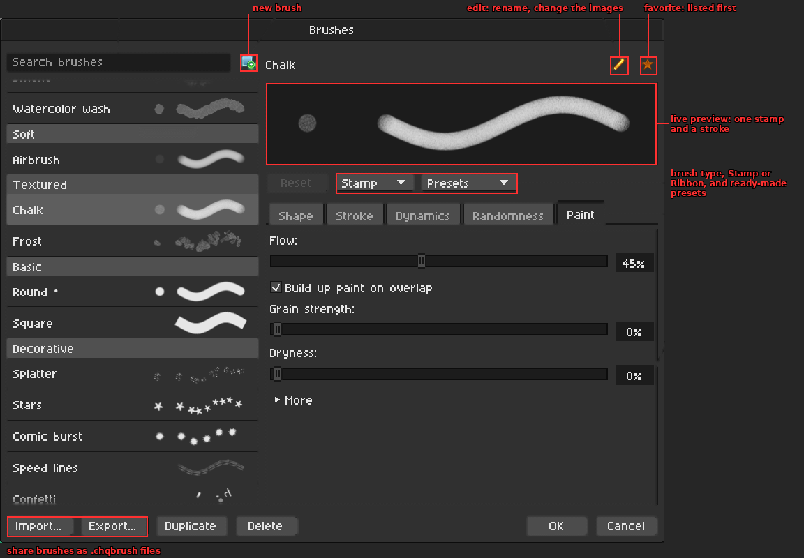

## The brush list

The list is on the left side of the dialog.

- **Search** filters brushes by name or category.
- Brushes are grouped by category: Basic, Classic, Soft, Textured, Decorative, Drawing, Painting, Tracks, Lines. Brushes you made or imported are under **My brushes**.
- The star button moves a brush to **Favorites**. That group is shown first, and you can drag its brushes to put them in order.
- The up and down arrow keys move through the list.

## Editing a brush

The right side of the dialog shows a live preview stroke and the settings of the selected brush. Changing a setting saves it right away.

Changes to a built-in brush are kept separately. The **Reset** button restores the original settings.

| Button | What it does |
|---|---|
| Pencil icon (**Edit**) | Lets you rename the brush and change its images. Finish with **Save** or **Cancel**. |
| **New brush** | Creates a brush from scratch. You are asked for a name first. |
| **Duplicate** | Makes a copy to experiment on. |
| **Delete** | Removes a brush from the library. A deleted built-in brush does not come back by itself. |
| **Import...** / **Export...** | Reads a brush from a file, or writes the selected brush to a `.chqbrush` file. |
| **Presets** | Replaces the settings with a starting point: Default, Pen, Airbrush, Calligraphy, Watercolor, Scatter, Stamp, Ribbon (pen). |

### Brush type

Every brush is one of two types, chosen in the **Brush type** list above the settings.

- **Stamp.** The tip image is repeated along the stroke. Most brushes are stamps: pencils, chalk, leaves, sparkles.
- **Ribbon.** The stroke is drawn as one continuous ribbon, like a pen or a marker. Ribbon brushes have no tip image. They can show bristle streaks and carry a repeating pattern along the stroke (a tire tread, a dashed line). Only ribbon brushes have the **Track layers** tab.

Settings that make no sense for the current type are hidden.

## Settings

The settings are split into tabs. A tab shows only the settings that apply to the current brush, and its less common settings are folded under **More**. Hover over a name to see a short hint.

The same brushes on the canvas, painted at width 30:

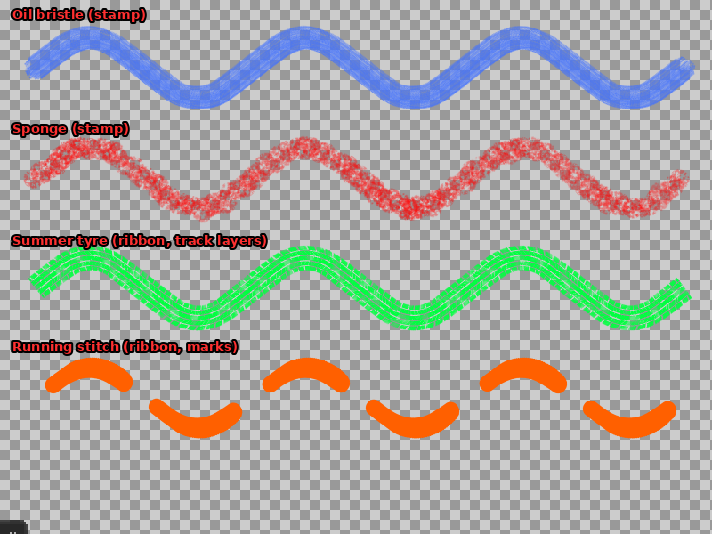

### Shape

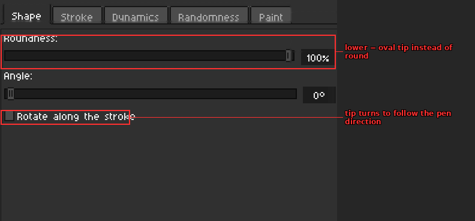

| Setting | Meaning |
|---|---|
| Hardness | How sharp the edge of the tip is. 100% is crisp, lower is soft. Only for the round tip. |
| Roundness | Squashes the tip. 100% is round, lower is oval. |
| Angle | Rotation of the tip in degrees. |
| Rotate along the stroke | The tip turns to follow the direction of the pen. Stamp only. |

### Stroke

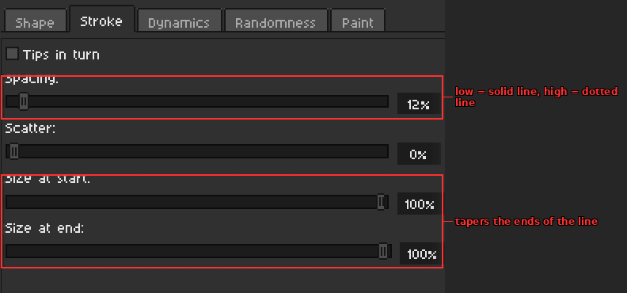

| Setting | Meaning |
|---|---|
| Tips in turn | The tips of a set are used strictly in order instead of randomly, for example a left and a right foot. Stamp only. |
| Spacing | Distance between stamps, as a percentage of the brush size. Low values give a solid line, high values a dotted one. Stamp only. |
| Scatter | How far stamps fly away from the line. Stamp only. |
| Size at start / Size at end | Brush size at the two ends of the stroke, as a percentage of the normal size. Use them for tapered lines. |
| Transition (× size) | **More.** The stroke length over which the size changes from start to end, measured in brush sizes. |

### Dynamics

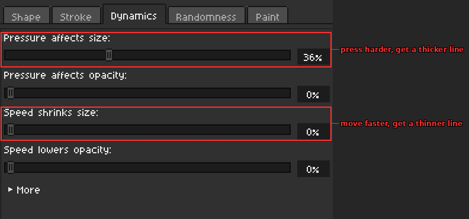

How the brush reacts to the pen and to your hand speed.

| Setting | Meaning |
|---|---|
| Pressure affects size | How much pressure changes the size. 0% means the size ignores pressure. |
| Pressure affects opacity | The same for opacity. |
| Speed shrinks size | The faster you move, the smaller the size. |
| Speed lowers opacity | The faster you move, the more transparent the stroke. |
| Pressure to size curve, Pressure to opacity curve | **More.** A curve editor that shapes how the effect grows with pressure. |
| Pressure affects roundness | **More.** Pressure changes the tip roundness. |
| Light pressure scatters | **More.** The lighter the pressure, the wider the stamps scatter. Stamp only. |
| Pressure affects edge hardness | **More.** Pressure changes the edge softness. Round tip only. |
| Light pressure widens spacing | **More.** The lighter the pressure, the sparser the stamps. Stamp only. |
| Tilt rotates the tip, Tilt flattens the tip | **More.** Pen tilt changes the tip. Needs a pen with a tilt sensor. |

### Randomness

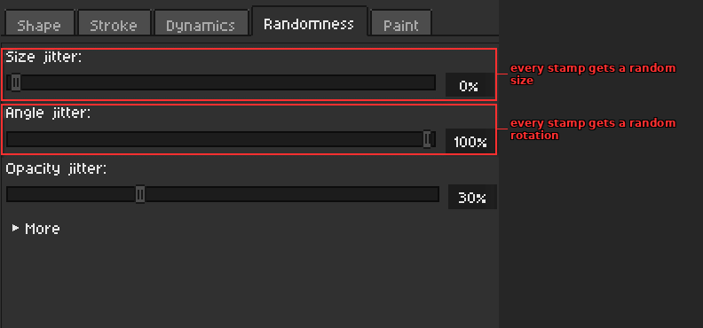

Every stamp gets a random variation. Stamp brushes only.

| Setting | Meaning |
|---|---|
| Size jitter, Angle jitter, Opacity jitter | Random size, rotation and opacity for every stamp. |
| Hue jitter, Saturation jitter, Value jitter | **More.** Random color shift on every stamp. |

### Paint

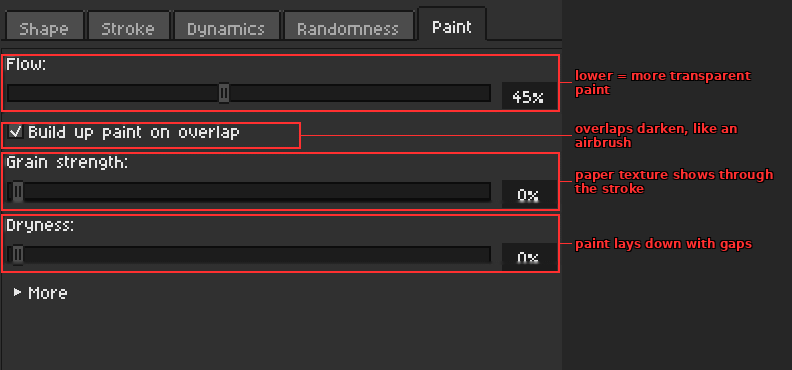

| Setting | Meaning |
|---|---|
| Flow | Paint laid down per stamp. Lower is more transparent and builds up slower. |
| Build up paint on overlap | Off: overlapping stamps do not darken. On: paint builds up like an airbrush. Stamp only. |
| Grain strength | How much the paper grain shows through the stroke. |
| Grain size, Texture | **More.** The size of the grain and the paper pattern it comes from. Shown when the grain strength is above 0. |
| Dryness | The stroke gets dry: paint lays down with gaps. |
| Speed dries, Light pressure dries | **More.** Dryness that grows with speed, or when the pressure is light. |
| Paint runs out along the stroke | **More.** The paint gradually runs out toward the end of the stroke. |
| Bristles (streaks) | Streaks from individual bristles along the stroke. Ribbon only. |
| Bristle pattern | **More.** How the bristles are laid out in the brush. Shown when bristles are above 0. |

The paper **Texture** can be generated (Noise, Fibers, Dots, Cells, Canvas) or loaded from an image file with **From file...**. The bristle pattern is generated, or can be loaded the same way.

### Track layers

Ribbon brushes only. A layer draws a pattern that repeats along the stroke. Several layers multiply together, so each one can hold back paint where it is light. The width of the picture is the stroke width, and its top is the direction of travel. A picture one pixel high is a profile across the stroke.

Dark or opaque pixels are paint, light or transparent pixels are a gap.

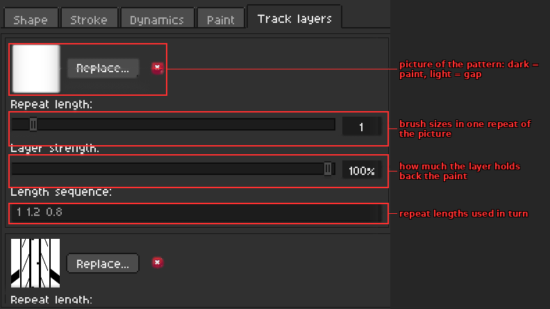

Add a layer with **Add a layer**, then choose how to make it:

- **From an image...** uses a picture.
- **From marks (dashes, dots, wave)** builds the pattern from simple shapes.

Layer settings:

| Setting | Meaning |
|---|---|
| Repeat length | How many brush sizes one repeat of the picture takes along the stroke. |
| Layer strength | How much the layer holds back the paint. |
| Length sequence | Repeat length multipliers used in turn, for example `1 1.2 0.8`. Tread blocks stop repeating identically. |

A mark is a shape repeated along the stroke. Everything is measured in brush sizes: the stroke width is 1. Several marks in one period make a dash-dot line.

| Mark setting | Meaning |
|---|---|
| Start | Where the mark begins inside the period. |
| Length | Mark length along the stroke. |
| Offset across | Shift from the middle of the stroke. |
| Thickness | Mark thickness across the stroke. 1 is the full width. |
| Rounding | From sharp corners to fully round ends. |
| Wave swing | How far the mark swings aside from the middle of the stroke. 0 is straight. |
| Waves per mark | How many full waves fit in the mark length. |

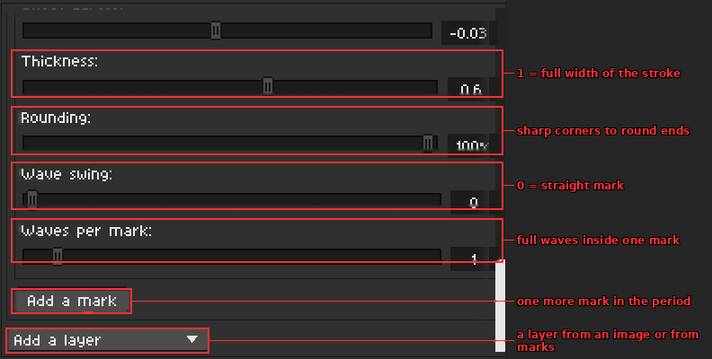

The built-in tire and footprint brushes (Tracks) and the stitch and dash brushes (Lines) are made this way.

## Brush images

A stamp brush paints with one or more images. Open the editing mode with the pencil icon and find **Brush images** in the Shape tab.

- **Add images...** adds pictures. A brush can hold up to 16.
- With several images, each stamp picks one at random. The number under an image is its share. Drag the images to change their order.
- A picture with transparency uses its alpha as paint. A picture without transparency uses its darkness: black is full paint, white is nothing. Sides from 1 to 4096 pixels.
- **Generate a tip** adds an image built by a program: Bristles, Comb, Split nib, Noise blot, Snowflake or Frost. Select a generated image to change its parameters, for example the number of teeth of a comb or how humid the air is for a snowflake.

Without images, a stamp brush uses a round tip.

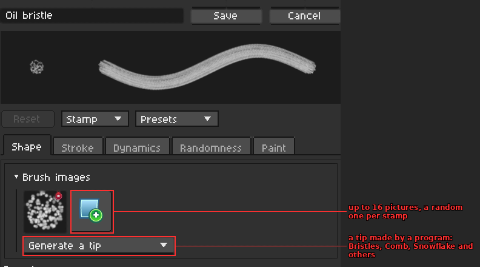

## Importing and exporting

**Import...** reads:

- Chequer brush files (`.chqbrush`), which may hold several brushes.
- GIMP brushes (`.gbr`), Photoshop brushes (`.abr`) and Krita presets (`.kpp`).
- Plain pictures (`.png`, `.jpg`, `.jpeg`, `.bmp`, `.gif`, `.webp`), which become the tip of a new brush.

Imported brushes are saved into your library as `.chqbrush` files. **Export...** writes the selected brush to one `.chqbrush` file, ready to send to someone else.

## Where the files are

The library lives in the `chequer` folder of your configuration directory: `$XDG_CONFIG_HOME` or `~/.config` on Linux, `%APPDATA%` on Windows, the application's private storage on Android.

| Path | What is in it |
|---|---|
| `chequer/brushes/*.chqbrush` | The library. One file can hold several brushes. You can drop files here yourself. The list is read when the program starts and after each change made in the dialog. |
| `chequer/active-brushes.chqbrush` | The current Paintbrush and Eraser brushes. |
| `chequer/brush-overrides.chqbrush` | Your changes to built-in brushes. |
| `chequer/favorite-brushes.txt` | The favorites, in order. |
| `chequer/seeded-brushes.txt` | Which built-in brushes were already copied to the library, so a deleted one is not restored. |
