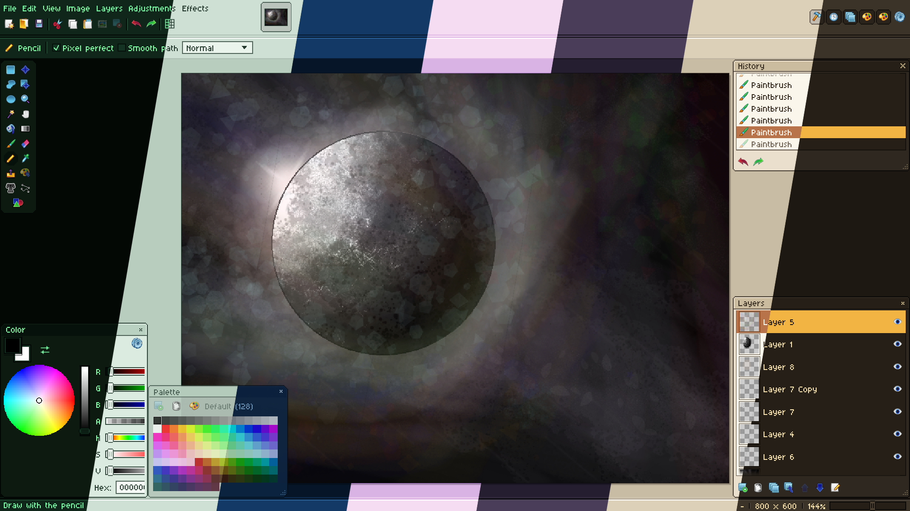

# Themes

Chequer comes with more than 30 themes. Pick one in **Settings → Themes**. A theme changes the colors, the pixel size of the interface and the corner style. Every theme has its own options (for example the corner radius), and every color of the current theme can be edited in the settings.

Pairs of a dark and a light theme: Mocha / Latte, Verdigris / Mint, Prussian / Scilla, Heliotrope / Thistle, Claret / Camellia, Gamboge / Primrose. There are also Default, Realistic, Gruvbox, Nord, Rose Pine, Tokyo, OLED, High contrast and others.



## Your own theme

A theme is a plain text `.ini` file. Put it in the `themes` folder inside the `chequer` folder of the configuration directory (`~/.config/chequer/themes/` on Linux, `%APPDATA%\chequer\themes\` on Windows). The file name without the extension is the theme id. Press **Reload list** in the Themes settings to see a new file. Parse errors are shown there too.

The easiest way is to inherit from an existing theme and change a few colors:

```
name=My theme
name.ru=Моя тема
base=default-dark
color.highlight=#e0925a
color.highlight_text=#2f2420
color.workspace=#2a201c
```

## Keys

| Key | Meaning |
|---|---|
| `name`, `name.ru` | Name in English and Russian. |
| `base` | Theme to inherit from. Default is `default-light`. `none` means no parent, and then all colors must be set. |
| `pixel` | Interface pixel size, 1 to 4. |
| `window_radius`, `button_radius` | Corner radius of windows and buttons. |
| `shadow_alpha` | Window shadow strength. |
| `bevel_rings` | Width of the bevel on buttons. |
| `color.<name>` | A color as `#rrggbb`. |
| `icons` | Name of a folder next to the file with replacement icons. |

Colors: `ink`, `ink_dim`, `ink_faint`, `line`, `line_soft`, `chrome`, `window`, `title`, `button`, `button_hover`, `button_on`, `field`, `list_hover`, `workspace`, `highlight`, `highlight_text`, `close_hover`, `close_hover_text`, `groove_dark`, `groove_light`, `checker_light`, `checker_dark`.

To replace an icon, put a 16×16 PNG with the icon's name in the icons folder, for example `pencil.png` or `save.png`. The names are the file names in `crates/chequer-app/assets/icons`.

## Theme options

A theme can add settings to the Settings window. Each one has a type (`toggle`, `number` or `choice`) and can drive the numeric keys above through a formula.

```
setting.round.type=number
setting.round.label=Rounding
setting.round.label.ru=Скругление
setting.round.min=0
setting.round.max=16
setting.round.step=1
setting.round.default=6

setting.flat.type=toggle
setting.flat.default=0

setting.mode.type=choice
setting.mode.options=Soft:4,Hard:0
setting.mode.default=4

bind.window_radius=round*2
bind.button_radius=round+mode
bind.shadow_alpha=(1-flat)*60
```

- `bind.<target>` is a formula where option names are replaced by their values. A toggle is 0 or 1, a choice is the value of the selected item.
- Targets: `window_radius`, `button_radius`, `shadow_alpha`, `bevel_rings`, `corner_style` (1 is round, 0 is bevel).
- A fixed value for a target in the file overrides an inherited formula.
- A theme that inherits can change only the default of an inherited option: `setting.style.default=0`.

The built-in themes are written the same way, see `crates/chequer-app/assets/themes/`.
